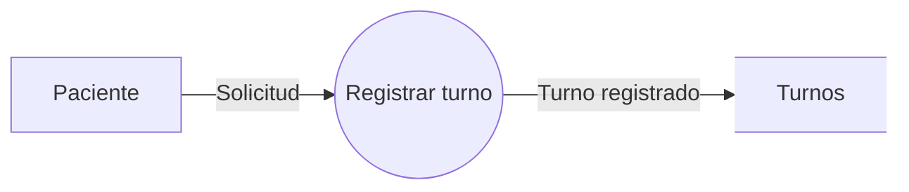

# Compilador para la Generación Automática de Diagramas de Flujo de Datos

Proyecto integrador de la asignatura **Compiladores**.

El proyecto implementa un compilador para un lenguaje de dominio
específico (DSL) orientado a la definición textual de Diagramas
de Flujo de Datos (DFD).

El lenguaje permite declarar entidades externas, procesos,
almacenes de datos y flujos mediante una sintaxis textual simple.

El compilador analiza la entrada y genera como resultado código
Mermaid que posteriormente puede ser renderizado como un diagrama.

---

# Arquitectura

El proceso general del compilador es:

```text
Código fuente .dfd
        |
        v
+-------------------+
| Análisis Léxico   |
|       Flex        |
+-------------------+
        |
        v
      Tokens
        |
        v
+-------------------+
| Análisis          |
| Sintáctico        |
|       Bison       |
+-------------------+
        |
        v
       AST
        |
        v
+-------------------+
| Análisis          |
| Semántico         |
+-------------------+
        |
        v
+-------------------+
| Generación        |
| Mermaid           |
+-------------------+
        |
        v
     archivo .mmd
        |
        v
     SVG / PNG
```

---

# Ejemplo

Código fuente:

```text
DFD "Sistema de Turnos" {

    ENTIDAD paciente "Paciente";

    PROCESO registrar "Registrar turno";

    ALMACEN turnos "Turnos";

    FLUJO paciente -> registrar "Solicitud";

    FLUJO registrar -> turnos "Turno registrado";

}
```

Salida Mermaid aproximada:



---

# Tecnologías

El compilador utiliza:

```text
Flex
Bison
C
GCC
GNU Make
Mermaid
```

Flex implementa el análisis léxico.

Bison implementa el análisis sintáctico.

El análisis semántico y el backend están implementados en C.

---

# Compilación

Desde MSYS2, parado en la raíz del proyecto:

```bash
make
```

El proceso ejecuta automáticamente:

```text
parser.y
   |
   | Bison
   v
parser.tab.c
parser.tab.h


lexer.l
   |
   | Flex
   v
lex.yy.c


archivos C
   |
   | GCC
   v
dfdc
```

---

# Ejecución

Ejemplo:

```bash
./dfdc examples/valid/turnos.dfd salida.mmd
```

Si la entrada es correcta:

```text
Analisis lexico: OK
Analisis sintactico: OK
Analisis semantico: OK
Mermaid generado: salida.mmd
Compilacion finalizada correctamente.
```

---

# Archivo de salida

Para visualizar el Mermaid generado:

```bash
cat salida.mmd
```

---

# Renderizado

Si Mermaid CLI se encuentra instalado:

```bash
mmdc -i salida.mmd -o salida.svg
```

También puede utilizarse:

```bash
bash scripts/render.sh salida.mmd salida.svg
```

---

# Escenarios de prueba

El proyecto incluye casos válidos e inválidos.

Para ejecutar todos automáticamente:

```bash
make test
```

Se comprueban actualmente:

```text
Caso mínimo válido
Sistema de turnos válido
Error léxico
Error sintáctico
Referencia inexistente
Identificador duplicado
Flujo semánticamente inválido
```

---

# Gramática

La gramática completa se encuentra documentada en:

```text
docs/GRAMATICA.md
```

La implementación real utilizada por Bison está en:

```text
parser.y
```

---

# Estructura del proyecto

```text
Compilador-DFD-Mermaid/
│
├── lexer.l
├── parser.y
├── ast.h
├── ast.c
├── semantic.h
├── semantic.c
├── mermaid.h
├── mermaid.c
├── main.c
├── Makefile
├── README.md
│
├── docs/
│   └── GRAMATICA.md
│
├── examples/
│   ├── valid/
│   └── invalid/
│
├── tests/
│   └── run_tests.sh
│
└── scripts/
    └── render.sh
```

---

# Estado actual

El prototipo contempla:

```text
[x] Lenguaje fuente propio
[x] Análisis léxico con Flex
[x] Análisis sintáctico con Bison
[x] AST
[x] Análisis semántico
[x] Generación de Mermaid
[x] Manejo de errores
[x] Casos de prueba
[x] Makefile
[ ] Definición definitiva de la notación gráfica
[ ] Ampliación de reglas semánticas
[ ] Soporte para niveles de DFD
[ ] Validación de balance entre niveles
```

---

# Autores

- Nicolas Gonzalez Heinrich
- Bewig Alejo
- Decunha Lucas
- Enriquez Emiliano

Universidad Gastón Dachary  
Compiladores — 2026
