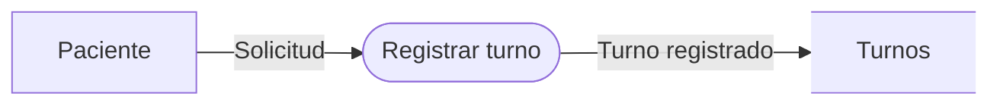

# Gramática inicial del lenguaje DFD-DSL

## 1. Objetivo

El lenguaje permite describir textualmente un Diagrama de Flujo de Datos mediante cuatro construcciones de dominio: **entidades externas**, **procesos**, **almacenes de datos** y **flujos de datos**. El compilador valida la entrada y genera Mermaid como lenguaje destino.

## 2. Tokens

| Token | Forma | Ejemplo |
|---|---|---|
| `T_DFD` | palabra reservada | `DFD` |
| `T_ENTIDAD` | palabra reservada | `ENTIDAD` |
| `T_PROCESO` | palabra reservada | `PROCESO` |
| `T_ALMACEN` | palabra reservada | `ALMACEN` |
| `T_FLUJO` | palabra reservada | `FLUJO` |
| `T_ARROW` | operador | `->` |
| `T_ID` | `[a-zA-Z_][a-zA-Z0-9_]*` | `paciente`, `p1` |
| `T_STRING` | cadena entre comillas | `"Registrar turno"` |
| `{ } ;` | delimitadores | `{`, `}`, `;` |

Los espacios, tabulaciones, saltos de línea y comentarios `// ...` o `# ...` no generan tokens.

## 3. Gramática BNF

Símbolo inicial: `<programa>`.

```bnf
<programa> ::= <cabecera> "{" <declaraciones> "}" <opt_semicolon>

<cabecera> ::= "DFD" STRING

<declaraciones> ::= ε
                  | <declaraciones> <declaracion>

<declaracion> ::= <entidad>
                | <proceso>
                | <almacen>
                | <flujo>

<entidad> ::= "ENTIDAD" ID STRING ";"

<proceso> ::= "PROCESO" ID STRING ";"

<almacen> ::= "ALMACEN" ID STRING ";"

<flujo> ::= "FLUJO" ID "->" ID STRING ";"

<opt_semicolon> ::= ε | ";"
```

## 4. Ejemplo válido

```text
DFD "Sistema de Turnos" {
    ENTIDAD paciente "Paciente";
    PROCESO registrar "Registrar turno";
    ALMACEN turnos "Turnos";

    FLUJO paciente -> registrar "Solicitud";
    FLUJO registrar -> turnos "Turno registrado";
    FLUJO registrar -> paciente "Confirmacion";
}
```

## 5. Reglas semánticas iniciales

La gramática anterior comprueba la **forma** de las sentencias. Luego se aplican reglas de significado:

1. Cada `ID` de `ENTIDAD`, `PROCESO` o `ALMACEN` debe ser único dentro del DFD.
2. El origen de todo `FLUJO` debe haber sido declarado.
3. El destino de todo `FLUJO` debe haber sido declarado.
4. Un flujo no puede tener exactamente el mismo elemento como origen y destino.
5. Todo flujo debe involucrar al menos un `PROCESO`. Por ello se rechazan conexiones directas `ENTIDAD -> ENTIDAD`, `ENTIDAD -> ALMACEN` y `ALMACEN -> ALMACEN`.
6. Todo flujo debe tener un nombre no vacío.

Estas reglas permiten demostrar la diferencia entre una sentencia sintácticamente correcta y una sentencia semánticamente válida.

## 6. Traducción al lenguaje destino

Ejemplo fuente:

```text
ENTIDAD paciente "Paciente";
PROCESO p1 "Registrar turno";
ALMACEN turnos "Turnos";
FLUJO paciente -> p1 "Solicitud";
FLUJO p1 -> turnos "Turno registrado";
```

Salida Mermaid aproximada:



## 7. Correspondencia con las fases de compilación

- **Flex:** reconoce palabras reservadas, identificadores, cadenas, delimitadores y `->`.
- **Bison:** comprueba que los tokens respeten la gramática y construye los nodos del AST.
- **AST:** conserva la representación estructural del DFD sin depender de Mermaid.
- **Análisis semántico:** resuelve identificadores y valida las reglas propias del dominio DFD.
- **Backend:** recorre el AST validado y genera Mermaid.

